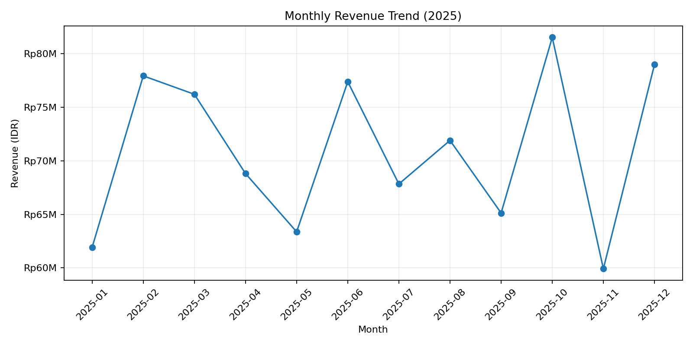
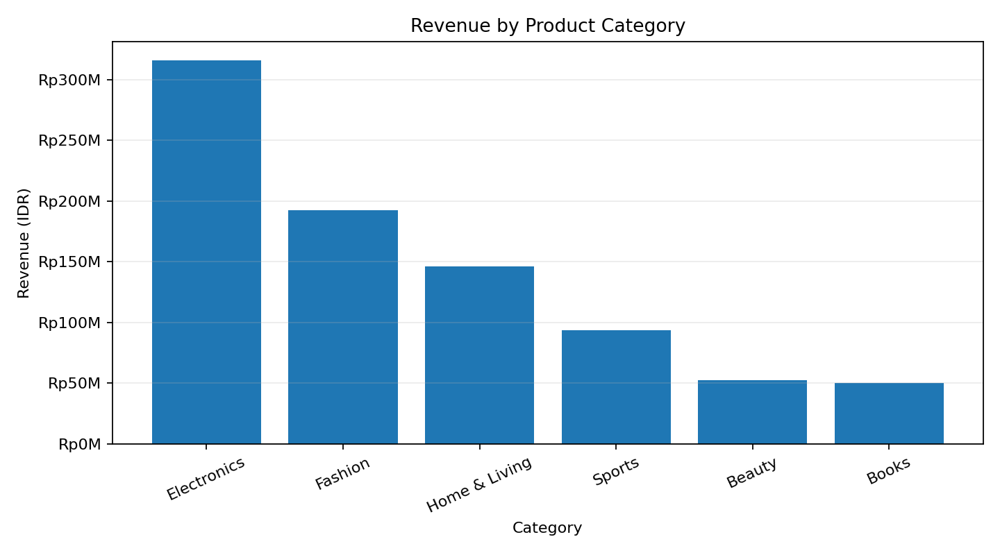
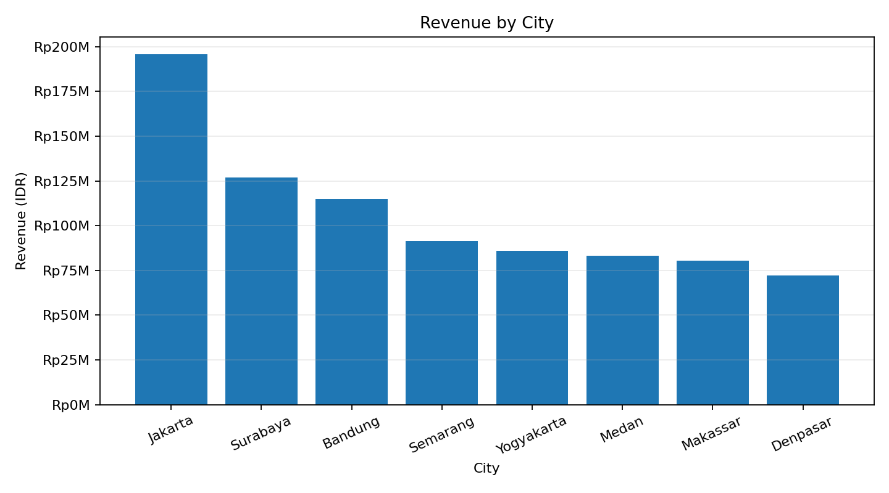

# Indonesia E-commerce Sales Analysis (Portfolio Project)

**Tools:** Python, pandas, Matplotlib, SQL (PostgreSQL)  
**Level:** Beginner–Intermediate | **Period:** Jan–Dec 2025  
**Dataset:** 2,400 simulated order records

## Project overview
An end-to-end data analyst portfolio project analyzing a simulated Indonesian e-commerce business. It demonstrates data validation, KPI calculation, exploratory data analysis, visualization, SQL querying, and business recommendations.

> **Data transparency:** The dataset is synthetically generated for portfolio practice. It is not sourced from a real company and must not be presented as actual market or company performance.

## Business questions
1. What are revenue, estimated profit, profit margin, and average order value?
2. Which months have the strongest and weakest revenue?
3. Which categories contribute the most revenue and profit?
4. Which cities generate the highest sales?
5. Which payment methods are most frequently used?
6. How do discount levels relate to average order profit?

## Repository structure
```text
.
├── data/ecommerce_orders.csv
├── notebooks/guided_analysis.md
├── outputs/
│   ├── monthly_kpis.csv
│   ├── category_performance.csv
│   ├── city_performance.csv
│   └── charts/
├── sql/analysis_queries.sql
├── src/analysis.py
├── requirements.txt
└── README.md
```

## Dataset dictionary
| Column | Description |
|---|---|
| `order_id` | Unique order identifier |
| `order_date` | Order date |
| `city` | Customer city |
| `category` / `product` | Product category and name |
| `quantity` | Units purchased |
| `unit_price_idr` | Unit price in rupiah |
| `discount_rate` | Discount as decimal (0.10 = 10%) |
| `revenue_idr` | Revenue after discount |
| `estimated_cost_idr` | Simulated estimated cost |
| `profit_idr` | Revenue minus estimated cost |
| `payment_method` | Payment method |
| `sales_channel` | Sales channel |

## Run locally
```bash
git clone https://github.com/your-username/indonesia-ecommerce-data-analyst.git
cd indonesia-ecommerce-data-analyst
python -m venv .venv
source .venv/bin/activate       # Windows: .venv\Scripts\activate
pip install -r requirements.txt
python src/analysis.py
```

The script checks data quality, calculates monthly/category/city KPIs, exports summary CSVs, and saves charts under `outputs/charts/`. SQL examples are in `sql/analysis_queries.sql`.

## Visualizations
### Monthly revenue


### Revenue by category


### Revenue by city


## Business recommendations (hypotheses to validate)
- Prioritize inventory for categories with strong revenue and profit contribution.
- Investigate weaker sales months before increasing promotional spending.
- Tailor city-level campaigns based on category mix and order economics.
- Evaluate discounts using profit per order, not revenue alone.

These are hypotheses from simulated data, not claims about real Indonesian consumers.

## Limitations
- Customer behavior and costs are simulated.
- Each row represents one order; no customer ID is provided.
- Retention and cohort analysis cannot yet be measured.
- Estimated cost is not audited cost of goods sold.

## Author
HANDUR
